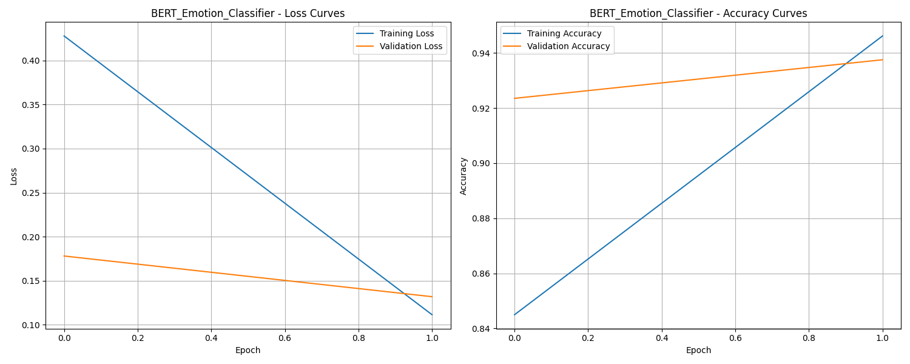

# EmotionSense2 — Emotion Classification Research

**Streamlit · BERT · GPT · Training & evaluation**

A research workspace for comparing text-emotion classifiers, exploring probability distributions and running training workflows.

## Project overview

| Component | Purpose |
| --- | --- |
| Streamlit interface | Text input, model selection, comparison and training controls |
| BERT and GPT classifiers | Model definitions and checkpoint loading |
| Training pipeline | Data preparation, fine-tuning and saved checkpoints |
| Evaluation tools | Model comparison and result visualizations |
| Demo mode | Illustrative interface output when PyTorch is unavailable |

The six labels are sadness, joy, love, anger, fear and surprise. Demo probabilities are generated for interface exploration and should not be interpreted as trained-model predictions.

## Interface setup

Create and activate a virtual environment, then install the application dependencies:

~~~bash
python -m pip install -r requirements.txt
streamlit run app.py
~~~

The UI requires Streamlit 1.27 or newer for its rerun controls. The dependency file intentionally omits PyTorch; install a compatible PyTorch distribution in the same environment when using model inference or training.

Trained checkpoint files and downloaded datasets are not committed. Model mode expects the local checkpoints described below.

## Training workflow

After installing PyTorch and the project dependencies, download/preprocess the dataset and train both classifiers:

~~~bash
python setup_and_train.py --num_epochs 2
~~~

To train one classifier after preparing the data:

~~~bash
python src/train.py --model bert --num_epochs 2
python src/train.py --model gpt --num_epochs 2
~~~

Use --help on the scripts to inspect batch-size, learning-rate and output-directory options. Training downloads model/data assets and requires suitable local compute.

## Checkpoints and results

| Path | Purpose |
| --- | --- |
| models/bert_emotion_classifier.pt | Local BERT checkpoint |
| models/gpt_emotion_classifier.pt | Local GPT checkpoint |
| src/data_processing.py | Data download, exploration and preprocessing |
| src/train.py | Fine-tuning entry point |
| src/evaluate.py | Evaluation and model comparison |
| results/ | Existing experiment figures |
| notebooks/ | Exploration scripts |

### Included experiment figure

This figure is an artifact included with the repository. The project does not claim independently verified production accuracy.

## Status

Research prototype. Results depend on the dataset, checkpoints and training configuration. The interface separates demo behavior from model-backed inference.

[Software engineering portfolio](https://github.com/rafayyqureshi/rafay-portfolio)
